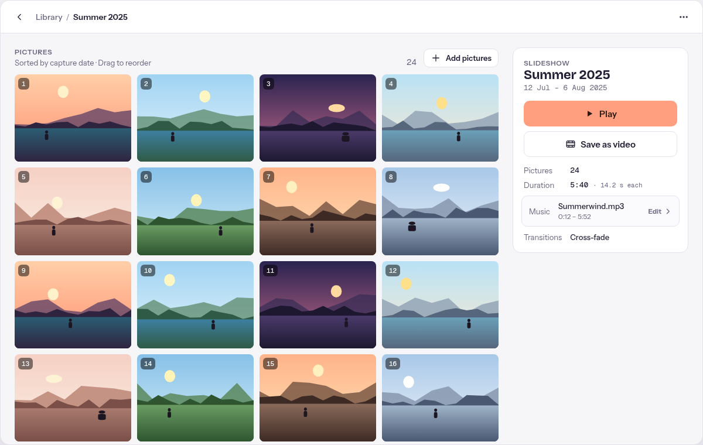
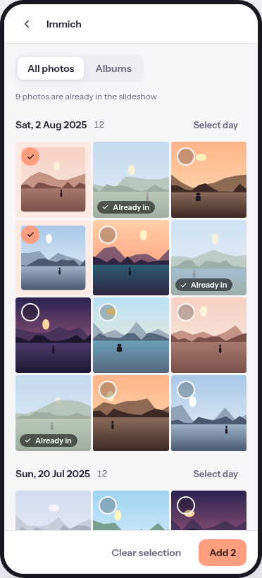

<p align="center">
  <picture>
    <source srcset="assets/brand/logo-stacked-dark.svg" media="(prefers-color-scheme: dark)">
    
  </picture>
</p>

<h3 align="center">Your photos and your music — turned into a slideshow that glides.</h3>

<p align="center">
  Ken Burns moves and smooth transitions, chosen for you. Private, installable, works offline.
</p>

<p align="center">
  <a href="https://polandy.github.io/glissando/"><b>Open Glissando</b></a> ·
  <a href="docs/user-guide.md">User guide</a> ·
  <a href="docs/self-hosting.md">Self-hosting</a> ·
  <a href="docs/development.md">Development</a>
</p>

<p align="center">
  
</p>

## Why Glissando

- **Good by default.** Pick pictures and a song; motion follows the people in a photo, scenery
  gets a slow sweep, and cuts land on the music. Override anything, or nothing.
- **Private and offline.** It runs entirely in your browser. Your pictures never leave your
  device, and once installed no server or internet is needed.
- **Take it anywhere.** Play full screen, save as an MP4 video, export a single HTML file, or
  move a slideshow between devices as a `.glissando` file.
- **Works with Immich.** Optionally run your own server to pick photos from
  [Immich](https://immich.app), keep slideshows for the whole household, share a link, or run an
  endless picture frame on the TV.

Current Chrome, Edge, Firefox and Safari (iPhone and iPad too), in English and German.

## Quick start

**On your device — 1 minute, no account, no server**

1. Open **<https://polandy.github.io/glissando/>**.
2. Install it: _Add to Home Screen_ on a phone, the install icon in the address bar on a computer.
3. **New slideshow** → add pictures → add a song → **Play**.

**On your server with Immich — 5 minutes**

```yaml
# in Immich's docker-compose.yml
services:
  glissando:
    image: ghcr.io/polandy/glissando:latest
    restart: always
    environment:
      IMMICH_URL: http://immich-server:2283
      IMMICH_API_KEY_FILE: /run/secrets/immich_api_key
    secrets: [immich_api_key]
    ports: ["8080:8080"]

secrets:
  immich_api_key:
    file: ./glissando-immich-api-key.txt # an Immich API key, see the guide
```

Then `docker compose up -d glissando`, put your HTTPS reverse proxy in front, and **protect it
with a sign-in or a VPN**. Step by step: [docs/self-hosting.md](docs/self-hosting.md).

<p align="center">
  
</p>

## Two ways to use it

|                    | On your device                                          | With your own server and Immich                                  |
| ------------------ | ------------------------------------------------------- | ---------------------------------------------------------------- |
| Get it             | open <https://polandy.github.io/glissando/>             | run the container next to Immich ([guide](docs/self-hosting.md)) |
| Needs              | nothing after the first load — works offline            | your server, reachable from your devices                         |
| Pictures from      | files on the device                                     | files on the device, or picked from Immich                       |
| Slideshows live    | in the browser on that one device                       | on the device, or on the server for every device at home         |
| Make, play, export | ✓ music, Ken Burns, transitions, video (MP4), HTML file | ✓ the same                                                       |
| Picture frame      | —                                                       | an Immich album, played endlessly                                |
| Share by link      | —                                                       | anyone can watch in a browser                                    |
| TV remote          | —                                                       | show on the TV, control it from the phone                        |
| Your pictures      | never leave the device                                  | stay with your devices, server and Immich, unless you share      |

## Documentation

| For          | Read                                             |
| ------------ | ------------------------------------------------ |
| Using it     | [User guide](docs/user-guide.md)                 |
| Running it   | [Self-hosting with Immich](docs/self-hosting.md) |
| Contributing | [Development](docs/development.md)               |
| Plans        | [Scope and roadmap](dev-docs/SCOPE.md)           |

Status: early development — see the [changelog](CHANGELOG.md).

## License

[MIT](LICENSE). The Baloo 2 font is licensed under the [SIL Open Font License 1.1](assets/fonts/OFL.txt).
