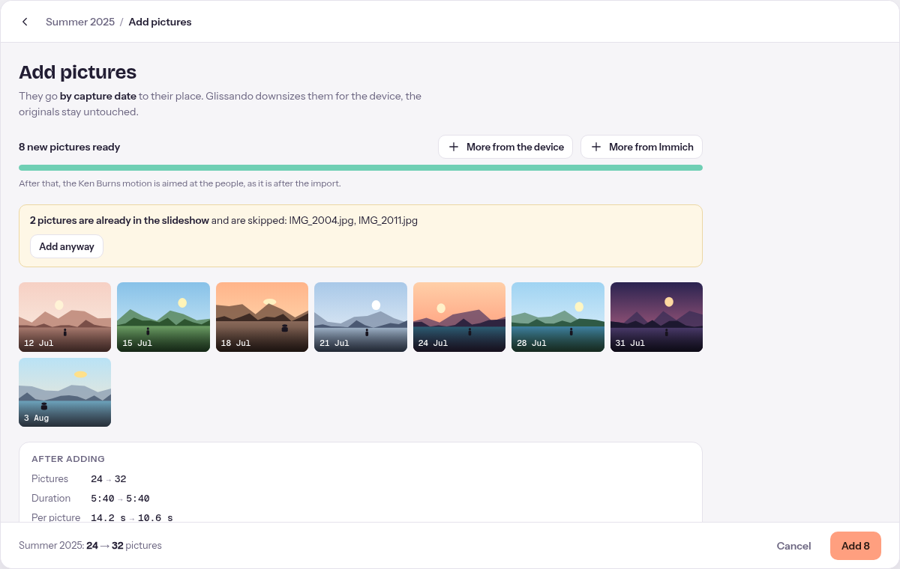

# User guide

## Get Glissando

Open <https://polandy.github.io/glissando/> and install it: **Add to Home Screen** on a phone or
tablet, the **install icon** in the address bar on a computer. After the first load it works
without internet. If you use a self-hosted Glissando, open its address instead
([self-hosting](self-hosting.md)).

## Make a slideshow

1. **New slideshow** and choose pictures from the device (or from Immich, on a self-hosted
   Glissando). They are ordered by capture date, and your pictures stay untouched.
2. **Add music**: any common format (MP3, M4A, Ogg, FLAC, WAV …), or pick from the nine sample
   songs that come with Glissando if you have none of your own to hand. Pick the part of the song
   to use; the slideshow is timed to fit it. Several songs work too, automatically matched in
   loudness so none plays louder than the rest; the music editor lets you listen and adjust that. It
   shows the essentials first: your songs (with **Add a song** as the last row), a bar showing how
   long the music and the pictures run, the picture length,
   **Repeat the music** and one line saying how pictures and music fit. Turn on **Details** in its top
   bar for the crossfades in that bar, the waveform, volume, beat and fades. The small **i** buttons
   explain a setting when you tap them.
3. **Play.** Motion and transitions are chosen for you — people stay in frame, scenery gets a slow
   sweep, changes follow the beat.

For a different feel, tap Mood beside Music and Look on the slideshow's screen (on a phone: Play first, then these three as one row of buttons with More settings below them, then the pictures). The Mood button shows only a short phrase; its sheet lists what it sets. **Calm** shows each
picture longer, with soft crossfades and gentle motion; **Lively** changes pictures quickly with
mixed transitions and stronger motion. Both fit the picture changes to the song's beat,
so a slow and a fast song pace the same mood differently. A new slideshow starts on Calm; choose
**No mood**, or set the picture length or "Fill the music" in the music editor, to use your
own settings. A slideshow without music sets its picture length in the music editor too, below
"No music yet". A picture with its own duration, transition or motion keeps it under any mood, and
changing a single setting while a mood is on turns the mood off, keeping its values as a start.

Turn on **Follow the music's energy** in the Mood sheet, with or without a mood, and the pictures
stay longer where the music is quiet and change quicker where it is loud; when the music picks up, the
next picture cuts in on the beat. The slideshow stays as long as before, and pictures with their own
duration keep it.

Tap Look on the slideshow's screen to give it a look — Warm, Cool, Vivid, Film, Black & white or
Faded — if you want one. It colours every picture and video, in the video and web page you share
too; the title and closing slides and the captions stay as they are.

  

While pictures are still coming in, you don't have to wait: view, remove or drag the ones already
there to set your own order — new ones join by capture date until you do — and keep adding more
(another folder, or more from Immich) while it runs.

Adding pictures later skips the ones already in the slideshow (you can add them anyway). Drag
pictures to reorder (on a phone, hold a picture until it lifts, then drag; the page scrolls along near the
screen edge), or tap Shuffle for a random order (Undo in the message that follows
brings the old one back); select a picture to view it full screen or open its editor to change
its motion (on a phone it shows the picture with its frames or the preview, one at a time:
switch with **Frame | Play**). The bar that appears labels every action: **Earlier**, **Later**, **View**, **Edit**,
**Insert chapter before**, **Move to …** and **Remove**; on a phone they form a second row, with
**Chapter** and **Move** as the short labels. **Move to …** goes to the start, the end, or before
a picture by its number — handy when dragging is too far.

**Trip chapters**: a slideshow of several days in different places gets a chapter slide between
them automatically, naming the place and the dates. Tap a chapter tile in the picture strip to
rename it, hide it, or reset it to its automatic text; select a picture and tap **Insert chapter before**
to add one of your own, or delete it again from its sheet. Deleting a chapter, resetting its
text, removing a title or closing slide and resetting a clip each show a message with Undo. The
**Trip chapters** switch in the slideshow's side panel, under **More settings**, turns automatic
chapters on or off for the whole slideshow; chapters you added stay either way.

## Play

| Key / gesture | Does             |
| ------------- | ---------------- |
| Space / tap   | Play, pause      |
| ← →           | Previous, next   |
| Esc           | Close the player |

## Keep and share

All of it is behind the **Share** button next to the slideshow's title. It opens a list in two
groups; choose a row and its sheet opens, with **Back** (or Esc) to the list and ✕ to close.

- **Watch by link** needs a self-hosted Glissando ([self-hosting](self-hosting.md)): a link anyone
  can watch, which stays up to date until you turn it off.
- **Video**: an MP4 you can send or put on a TV stick.
- **Web page**: one file that plays in any browser, no Glissando needed.
- **Glissando file**: **Save file** moves a slideshow with its pictures, music and settings to another
  device; import it there. Glissando checks a file whole, every picture and song included, before
  it keeps anything of it, and refuses a file that is damaged or not what it claims to be. The
  file is a ZIP: rename it to `.zip` to look inside. A copy you unpacked, edited and zipped again
  (the folder itself or its contents) still opens; missing thumbnails are made again, also where you deleted a picture's `thumbnail`
  line from `glissando.json`. Inside, `README.txt` says what each entry is, and
  `glissando.schema.json` describes `glissando.json` as a JSON Schema. To watch it without
  Glissando, unpack the whole file and open `index.html` in a browser; Firefox plays at once,
  Chrome, Edge and Safari ask you to choose the unpacked folder first. It plays what
  `glissando.json` says, so your edits show.
- **TV, picture frame** need a self-hosted Glissando ([self-hosting](self-hosting.md)): a TV you
  control from the phone (`/tv`), and an Immich album played endlessly (the Picture frame card,
  or Settings).

## Good to know

- The path at the top (Library / your slideshow / …) is tappable: **Library** brings you home from
  any screen.
- If the music is a little shorter than the pictures, they shrink to fit it on their own. If it
  ends well before the pictures do, the music editor says so and offers **Repeat the music**; you
  can also add a song.
- Glissando looks for faces and other subjects in the background, so motion aims well; while it
  runs, the bar at the top of every screen and each card show how far it got. **Faces and subjects
  …** in a slideshow's ⋯ menu lets you look again at any picture,
  including one it couldn't look at the first time.
- The phone's back gesture or the browser's back button asks before it drops pictures you have
  chosen but not yet used, the same as the Back arrow.
- Your pictures stay on your device. Nothing is uploaded unless you use a server you run yourself.
- Ask the browser to keep the data (Glissando requests it); clearing site data deletes slideshows
  stored on the device — save a `.glissando` file as a backup.
- Language and light/dark follow your device; both can be changed in Settings.
  Immich and the server quality settings appear in Settings only when Glissando runs with its own
  server (see the self-hosting guide).
